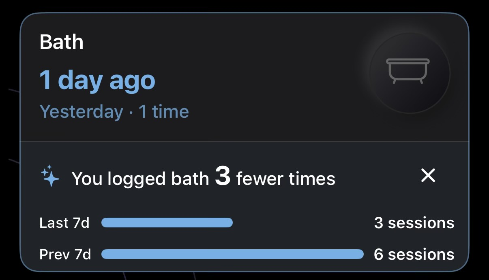

# Nubo website positioning and organic search proposal

Rewritten September 29, 2026. Status: proposal for implementation, with an audit of the current site.

October 1, 2026: the homepage positioning and visual hierarchy below are superseded by the [Nubo Care homepage and hospital to home proposal](/Users/guru/Projects/Nubo/nubo-web/homepage-nubo-care-plan.md). Retain this document's useful audit context; use the newer proposal for the next homepage revision.

## The decision

Make Nubo clearly recognizable as **a modern baby tracker app for iPhone and Android, with free AI voice logging, quick logs, and one shared care timeline**. Use “modern” as an explicit umbrella for the experience, then define it through concrete capabilities. Explain on-device privacy and catching up on missed events as benefits of voice logging. Show the optional device as a useful extension of the app. Build a small set of convincing product and decision pages around this position, supported by real demonstrations and carefully maintained comparisons.

The ambition is to earn consideration among the best modern baby tracking solutions. The website can explain and demonstrate why Nubo deserves that consideration. It cannot make Google independently endorse Nubo as the best app simply by repeating that claim, changing the hero, or adding schema. Our near-term objective is qualified visibility for specific baby tracker needs, followed by broader category visibility as evidence and recognition grow.

This replaces the September 28 homepage-only proposal. It also revises the priorities in the older [site architecture proposal](site_architecture_proposal.md) and the hardware-led assumptions in [content_strategy.md](content_strategy.md). Working product code remains the source of truth. Existing content workflow and style rules still apply; obsolete positioning and unverified competitor claims should be reconciled during implementation. This review changes the proposal, not the public site, product entitlements, or deployment settings.

## What the review establishes, and what it does not

Reviewed the referenced chat, local homepage and product pages, shared layouts, navigation, metadata, content strategy, selected existing articles, generated HTML and sitemap, the live homepage and app page, store listings, public search samples, and current Google Search Central documentation.

| Evidence checked on September 29 | Finding | Meaning |
| --- | --- | --- |
| Public searches for Nubo and `site:nubotracker.com` | Results include Nubo's app listing and website pages such as `/app/`, `/device/`, `/caregivers/`, and `/faq/`. A result also surfaces the retired `/how-it-works/` URL. | Nubo has public search visibility. This is not proof of Google's complete index or of rankings for unbranded queries. Search samples may contain stale content. |
| Generic baby tracker search samples | The returned set includes established products, discussion threads, and many competitor-owned comparison pages. Nubo was not prominent in the sampled broad discovery results. | Broad category competition is substantial. A competitor's roundup is marketing evidence, not an independent verdict. This is a directional observation, not a controlled Google rank report. |
| Live HTTP checks | HTTPS homepage, app page, robots file, and sitemap index return 200. The homepage and app page use the expected HTTPS canonical URLs and have no meta `noindex`. | The checked entry points are reachable and do not show an obvious blanket indexing block. This does not establish every URL's indexing status. |
| Local build | `npm run build` succeeds and produces 72 HTML pages. | Astro static output already provides a workable SEO foundation. A platform rewrite is unnecessary. |
| Generated internal link check | One distinct missing target, `/#reviews`, appears in 69 links through the shared footer. No missing internal files were found in this check. | The Reviews path is a real trust and navigation defect. Fix it before adding more credibility language. |
| Desktop and 390 × 844 homepage browser review | The hero emphasizes the physical device. On the phone-sized screen, the large visual comes before the headline; the device CTA reaches the bottom of the first screen and the app CTA is below it. | The first encounter makes the app look secondary. This is observed presentation, not an inferred ranking penalty. |
| Nubo US App Store listing | Eight ratings were visible at review time. Its description includes Live Activities in both free and upgrade descriptions, while the website labels them Nubo Plus on iPhone. | There is some external feedback, but not enough to support a market-leading popularity claim. Resolve the entitlement contradiction before expanding the message. |
| Search Console, Plausible reports, and app acquisition reports | No private reports were available in this review. | We cannot identify the main ranking bottleneck, quantify search demand, establish conversion baselines, or claim a Google penalty. |

Public evidence: [Nubo app page](https://www.nubotracker.com/app/), [caregiver page](https://www.nubotracker.com/caregivers/), [US App Store listing](https://apps.apple.com/us/app/nubo-voice-baby-tracker-log/id1667461158), and [Google Play listing](https://play.google.com/store/apps/details?id=com.clicksie.nuboapp). Google explains that [`site:` results are not exhaustive](https://developers.google.com/search/docs/monitor-debug/search-operators/all-search-site). Use Search Console URL Inspection for the Google-specific diagnosis.

**Working hypothesis:** Nubo's category clarity and evidence are weaker than its actual product proposition. That is actionable now. Indexing problems, link authority, query relevance, and competitive strength remain separate hypotheses until the private data is checked. Do not label the site unindexed or blame one technical defect for all missing rankings.

## Critique of the previous proposal

The previous plan correctly moved toward an app-first hero, direct store downloads, real UI, and ordinary parenting moments. It correctly kept forecasts behind a release gate and rejected absolute privacy claims. Keep those decisions.

Its central weakness was treating an attractive, simpler homepage as the main solution. That helps conversion, but it leaves most of the acquisition problem unanswered.

| Previous direction | Critique | Revised decision |
| --- | --- | --- |
| “Baby tracking that lightens the mental load” | A useful benefit, but too interchangeable to carry the whole position. It does not explain why Nubo deserves a place beside other trackers. | Pair relief with the product category and demonstrable reasons: free AI voice logging, quick logs, cross-platform shared care, and optional physical buttons. Explain on-device processing beside the voice demonstration. |
| Copy Robin's clean presentation | Robin is a reference for clarity, not a validated model for Nubo's ranking or conversion. Its AI and forecast proposition belongs to its released product. | Use Nubo's actual workflows as the design brief. Avoid describing the app as proactive or predictive before forecasting ships. |
| Preserve SEO through a few natural keywords | Necessary but incomplete. No page ownership, query baseline, comparison evidence, or indexing investigation was defined. | Assign search intents to existing URLs and make each page useful for that decision. Measure in Search Console. |
| Keep the homepage very short | Removing every detail can make the site less useful to a parent evaluating an unfamiliar app. | Keep the hero concise, then provide specific demonstrations, limitations, pricing boundaries, and useful deeper links. Do not impose an arbitrary word count. |
| Voice visualizer and animation | A waveform shows sound, not a successful baby log. It can become decoration or delay shipping. | Show the spoken input, the resulting entry, and its timestamp. Begin with real static frames and text; add video when available. |
| Conversion baseline before launch | Store clicks alone cannot tell us whether Nubo has become discoverable. Waiting for a two-week baseline should not hold up obvious repairs. | Capture available historical data immediately, fix defects, and track both organic acquisition and store outbound clicks. |
| Forecasts as the future third major benefit | Sensible roadmap thinking, but too much product design detail in the immediate website plan can distract from current proof. | Preserve the forecast principles in an internal appendix. Current app clarity and evidence ship first. |

## Critique of the current positioning

The current website says “ecosystem,” but repeatedly presents **hardware first and a companion app second**: the homepage eyebrow, primary CTA, hero device overlay, first navigation item, footer tagline, default social image, and homepage Product schema all reinforce the physical tracker. That is coherent for selling a device. It is weaker for establishing an app people can use immediately without a purchase.

The app page is clearer about being free and cross-platform, but it moves quickly from a feature-rich introductory paragraph to an iPhone Plus feature and a long entitlement table. The practical payoff of voice catch-up, last-event context, and shared care deserves proof before the table.

The older strategies also overstate the distinction. Claims such as “every app-based log requires unlocking,” “only tracker,” and a universal 18-second competitor entry do not hold up as category-wide statements. [Robin's listing](https://apps.apple.com/us/app/baby-tracker-robin/id6762530883) includes voice, watch, widget, and Live Activities options. [Huckleberry's pricing page](https://huckleberrycare.com/pricing) lists voice logging, shared tracking, predictions, and insights. Their existence does not weaken Nubo's real strengths; it requires more precise comparisons.

There are credibility problems in existing articles that should be corrected before commissioning more SEO content:

- `catch-up-baby-logging-after-the-fact.mdx` calls voice the fastest method “full stop,” assumes cloud voice always entails limits or a subscription, and uses an unsupported “Half the entries” excerpt. Demonstrate Nubo's behavior and remove universal assertions without comparative evidence.
- `best-baby-tracker-for-nanny-grandparents.mdx` compares paper, apps, and devices rather than named apps. It also implies immediate remote visibility from device taps. Explain that the device queues events until a nearby paired phone syncs them, and sharing requires connectivity. Do not present delayed sync as immediate.
- `BlogLayout.astro` describes “Nubo Team” as a `Person` and has a feeding CTA that can imply private pumping is free. The privacy CTA says there are no tracking scripts while the site uses Plausible. Align authorship, tier boundaries, and analytics wording with reality.
- The content strategy still identifies the app as a companion, uses a former GitHub website address, prescribes a recurring paper/app/device reveal, and contains unverified exclusivity claims. Applying that pattern to every article makes app-focused content feel like a hardware pitch.

These are accuracy and usefulness issues, not evidence of a Google sanction. Repair the relevant passages; do not erase the blog or remove indexed pages indiscriminately.

### The position to build around

**Category:** Modern baby tracker app for iPhone and Android, with free everyday tracking.

**Promise:** Beautifully simple tracking that makes the daily work of early parenthood feel easier. Lead with ease, connected care, and useful context.

**Reason to choose Nubo:** Record care with quick taps or free AI voice logging, catch up on missed events in natural language, find the last event without searching, and keep invited caregivers on the same timeline. Voice processing runs on the phone. Add physical buttons when reaching for a phone is inconvenient.

**One-sentence product description:**

> Nubo is a modern baby tracker app for iPhone and Android with free AI voice logging, quick logs, and caregiver sharing. Turn spoken feeds, naps, and diaper changes into structured logs on your phone, see useful context beside the action, or add an optional screen-free device.

### Define modern, and say it explicitly

Use **modern baby tracker** in the main position and homepage headline. It is a useful umbrella for people looking for a current, thoughtfully designed alternative, even when they have not yet named each capability they want. Let the word invite that recognition, then resolve its ambiguity with specific features and real UI. Name AI where it describes a real capability, then demonstrate the result.

**Nubo's definition of modern:** Less effort to record care, more useful context when you need it, and one connected record across the people and tools you use.

| Dimension | What modern means for a parent | Current evidence or release boundary |
| --- | --- | --- |
| Clean, intuitive interaction | Common actions and the last event are easy to find, including when one hand is busy. | Demonstrate Quick Action cards and short logging flows. Validate intuitive use with actual parents; a clean appearance alone does not establish ease of use. |
| AI voice logging | Say what happened naturally, including events remembered later, and get structured logs. | Current free in-app capability. Show input, output, event time, and any correction step. |
| Flexible capture beyond the app | Log in the way that fits the moment, with optional dedicated physical buttons. | Current device capability. Hardware expands Nubo's workflow; it is not a prerequisite for using the app or a universal definition of a modern tracker. |
| Just-in-time context | See the last event and relevant trends beside the action instead of reconstructing the day from charts. | Current last-event context and Nubo Plus personalized insights. Show the supplied Quick Action pattern with accurate tier labels. |
| Useful interpretation and preparation | Help connect recorded patterns and, when supported, prepare for what may come next. | Demonstrate current insights precisely. Feed and nap forecasts remain behind the release gate. Confirm which insight functions actually use AI before labeling them AI-powered. |
| Connected, private care | Share across iPhone and Android, work offline, and keep personal information under family control. | Current caregiver, offline, and privacy capabilities, with synchronization and platform boundaries explained. |

“Connecting the dots with AI” can be valuable positioning once it is tied to an actual answer the product provides. Describe the recorded relationship or change, what the parent can do with it, and the implementation that supports the AI label. Do not imply that every statistical trend is AI-generated, that Nubo explains the cause of a baby's behavior, or that current insights already forecast the next event.

**Current supporting copy:** “AI voice logging, quick taps, helpful insights where you log, and one shared timeline. Add the Nubo device when a physical button fits the moment.” Label the Plus insight at the point of use. After forecasting ships, add “feed and nap forecasts” explicitly with a real example; do not publish a roadmap list under the current modern promise.

Use the phrase naturally in the homepage headline, one descriptive title, and a short explanation of what makes the experience modern. Keep explicit capability headings such as AI voice logging and caregiver sharing underneath it. The app page can retain its more specific free-app title. Avoid repeating modern in every heading, adding it to every title, or creating a separate thin modern-tracker landing page.

Treat “modern baby tracker” as a positioning phrase and a search-intent hypothesis, not a verified high-volume keyword or a Google-defined product class. Public search samples show other vendors using it, but do not establish its demand or a ranking advantage. Google's [title guidance](https://developers.google.com/search/docs/appearance/title-link) favors concise, descriptive titles and discourages keyword stuffing. Our rationale for using modern is reader recognition plus a clear description, not a claimed special ranking boost.

The free app must also make sense for one parent tracking alone; shared care is a strength, not an eligibility requirement.

### Name the capability before explaining the benefit

The earlier proposal underplayed AI by using “private voice catch-up” as the primary feature name. That describes a scenario and a privacy property, but leaves readers and comparison systems to infer the capability. Lead with **AI voice logging**. Explain **catch up on missed logs** as a use case and **on-device processing** as a distinction. Benefit-focused copy should translate the technology, not conceal it.

| Layer | Preferred language | Purpose |
| --- | --- | --- |
| Recognizable capability | **AI voice logging** | Makes the feature explicit for app shoppers and comparisons of voice AI baby trackers. |
| Plain-language explanation | **Say what happened. Nubo turns it into a baby log.** | Explains that this creates a structured event, rather than merely saving a recording or dictated note. |
| Practical use case | **Catch up on a missed feed or nap, with the time it happened.** | Shows why natural-language input is useful during a real day. |
| Product distinction | **Free, with voice processing on your phone.** | States the entitlement and privacy advantage without replacing the category name. |

Use the same capability name in homepage and app copy, relevant headings, comparison rows, metadata, visible FAQs, and the app's structured description or feature list. Align store descriptions and existing public summaries when implementing. Keep “voice catch-up” as useful explanatory language, not the only name. Do not rename indexed article URLs merely to insert AI.

This is a clarity decision, not proof that missing the exact phrase caused low rankings. Google describes semantic matching through systems such as RankBrain and neural matching in its [ranking systems guide](https://developers.google.com/search/docs/appearance/ranking-systems-guide). Our inference is that explicit, consistent capability language gives parents and systems less to infer; it does not guarantee inclusion in Google results or other AI answers.

For comparison and answer passages, publish a concise factual explanation: **“Nubo includes free AI voice logging on iPhone and Android. It turns natural-language descriptions of feeds, naps, and diapers into structured baby logs, including events remembered later. In-app voice processing runs on the phone.”** Follow it with a real example and result. Verify platform behavior before publication. Distinguish structured voice logging from voice notes, Alexa logging, forecasts, and a medical chatbot; “AI” should not imply every one of those capabilities.

**Voice workflow clarification, September 29:** The product owner confirms that on-device AI processes one event at a time. A roughly half-second pause ends an event description, and its result is returned within roughly 100ms before the parent describes the next event. These are owner-reported implementation details, not published performance benchmarks. The owner also specifies less than a minute to log a full day's care this way. Use **“Log a full day's care. In less than a minute.”** as the benefit headline, supported by **“Say what happened. See each result in a blink. Keep going.”** Avoid “one voice note,” which can suggest that one recording becomes many entries only after it ends. Demonstrate a representative day's catch-up and original event times with actual product captures; pause lengths and processing timings do not belong in the homepage explanation.

| Benefit | What demonstrates it | Boundary to make clear |
| --- | --- | --- |
| AI voice logging without reconstructing a form | Real natural-language voice input becomes a feed or nap entry at the original event time. | Use tested phrases. Identify in-app AI voice logging separately from voice notes and Amazon Alexa. |
| See where the day stands | A real Quick Action card shows the last event and daily context. | Personalized insights are Nubo Plus; they describe recorded activity. |
| Hand off with less explaining | A partner's entry appears in the shared timeline across iPhone and Android. | Say when data syncs. Do not imply offline phones or an out-of-range device provide instant remote updates. |
| Start without a subscription or device | Name the free routine tracking, voice, caregiver, backup, and offline features. | Nubo Plus is optional. Private pumping and other paid tools are labeled. Confirm the released platform details. |
| Log without reaching for a phone | A real device tap and subsequent app entry. | The device is optional, uses Bluetooth, and is purchased directly on Amazon. |
| Keep family information private | Plain-language explanation of voice processing, sharing, backup, and private pumping. | No “100% private” promise. Alexa uses Amazon's systems; privacy is not a claim of medical security certification. |

Use “Nubo Plus” in current public copy, matching the implementation. Older documents call the upgrade Premium. Confirm the naming and current entitlements with the released app, then keep the website and both stores consistent. The source currently shows $39.99/year and a device offer of $89, reduced from $109; older instructions say $89.99. Verify the actual offer rather than silently treating either document as authoritative pricing.

## Search strategy: earn relevance before claiming leadership

Start with branded discovery and the needs Nubo can demonstrate now: free tracking, AI voice logging, missed-log catch-up, shared care across iPhone and Android, and privacy. Include AI baby tracker comparison intent explicitly, describing the AI functions Nubo offers today. Build toward `best baby tracker app` with a substantive comparison and stronger external recognition. Keep broad category visibility as an ambition throughout; focused queries are the initial route, not a permanent niche restriction.

The phrases below are **intent hypotheses, not verified search-volume or difficulty estimates**. Default reporting market: US English, with other countries reported separately. Reprioritize using actual query impressions and acquisition data.

| Search intent | Initial page owner | Page's distinct job |
| --- | --- | --- |
| Nubo, Nubo baby tracker, Nubo app | `/` | Establish the brand, app category, key reasons to choose it, and direct download paths. |
| Modern baby tracker, modern baby tracking app | `/` with deeper evidence on `/app/` | Explicitly define the modern experience through interface, AI voice logging, useful context, sharing, and optional hardware. Validate demand rather than treating the phrase as a separate category to dominate. |
| Free baby tracker app, baby tracker iPhone and Android | `/app/` | Demonstrate the app, explain free and Plus boundaries, show platforms and installation details. |
| Best baby tracker app, baby tracker app comparison | `/compare/` | Help choose among actual named apps by need, with sources, limitations, and evidence. Move Nubo setup selection to `/pricing/`. |
| Baby tracker without subscription | Existing `free-baby-tracker-no-paywalls` article | Explain what remains free and how previews and optional upgrades differ. Link to `/app/` and `/pricing/`. |
| AI voice baby tracker, baby tracker with AI voice logging, voice AI baby tracker, logging after the fact | `/app/#voice-catch-up` plus the existing catch-up article | App page explicitly names and proves AI voice logging; article explains missed-log situations, editing, and timestamps. The app anchor is proposed, not present today. |
| AI baby tracker, AI baby tracker app comparison | `/app/` and `/compare/` | Explain the available AI functions and compare voice logging separately from insights, forecasts, and chat assistance. Do not imply that Nubo offers every feature associated with the AI category. |
| Shared baby tracker, caregiver sync, iPhone and Android parents | `/caregivers/` | Show invitation, logging, synchronization, handoff, and privacy boundaries. |
| Nubo vs Huckleberry, Nara, or Nighp | Existing three comparison article URLs | Give a specific keep/switch decision. Preserve the URLs rather than creating duplicates under `/compare/`. |
| Private baby tracker, baby tracker voice privacy | `/privacy/` and existing privacy articles | Overview explains Nubo's architecture; articles answer narrower questions. No blanket competitor accusations. |
| Physical baby tracker, screen-free tracking, Talli alternative | `/device/` and `/compare/talli/` | Explain physical logging, sync, hardware tradeoffs, and direct Amazon purchase. |
| Exclusive pumping tracker | Existing `/exclusive-pumping/` and relevant articles | Explain shared baby intake versus private milk-output records, with the correct paid boundary. |

A page owner is an editorial choice, not an instruction to Google or a reason to canonicalize different useful pages together. The homepage can naturally describe a free app while `/app/` provides deeper product evidence. Both should remain self-canonical. If Search Console shows pages alternating on the same queries, inspect whether their purpose and content actually overlap before changing anything.

Do not launch new feed, sleep, voice, or privacy landing pages merely to repeat app copy. Use useful app sections and the existing first-12-weeks guide first. Add a distinct URL only when there is a distinct user task, substantial product evidence, and a reason it cannot be served well by an existing page.

### Internal links that help the next decision

Make App the first product navigation item, followed by Device, Pricing, Compare, and Resources. The header download action should bring the two store choices into view without forcing an unnecessary tour. The homepage hero and closing section link directly to both stores.

On the homepage, link to the free app, voice demonstration, caregiver sharing, privacy, and app comparison where each answers the question in that section. On relevant articles, use a brief contextual route to the app proof section. For example, missed-log guidance points to voice catch-up; caregiver guidance points to invitation and sync instructions. Do not append an identical sales block or keyword list to every article.

The comparison hub links to the three existing competitor articles. Those articles link back to the hub, relevant app evidence, and download options. Keep hardware comparisons distinct from app comparisons. Resources should organize existing articles by parent task rather than become another feature directory.

## Homepage specification and proposed copy

The hero needs both category clarity and relief. For the September 29 wireframe, retain the existing mother, device, and app-carousel visual as requested. Put the app category, benefit, and direct store choices before that composition on mobile. The supporting sections carry the clearer product demonstrations, with labeled placeholders until real captures are ready.

**Proposed title:** `Nubo | Modern Baby Tracker with AI Voice Logging`

**Proposed description:** `Meet Nubo, a modern baby tracker for iPhone and Android. Use free AI voice logging, quick taps and caregiver sharing. Add an optional screen-free device.`

**Hero copy:**

> **Free baby tracker app for iPhone and Android**
>
> # A modern baby tracker. Beautifully simple.
>
> Log with a tap or your voice, keep caregivers in sync, and see helpful insights at a glance.
>
> **Download on the App Store** · **Get it on Google Play**
>
> AI voice logging, quick logs, and caregiver sharing are free. Voice processing runs on your phone. No device required.

The hero ends with the store choices and the free-feature note. One-tap logging and AI voice logging are demonstrated in the next feature sections, so the hero does not need an additional missed-feed link. The demonstration should not require microphone access or an account.

| Order | Heading and starting copy | Product evidence and destination |
| --- | --- | --- |
| 1. Hero | Copy above. | Retain the existing hero composition for this wireframe. Text and store choices precede the visual on mobile. |
| 2. One-tap app logging | **Log at the speed of thought.** A dirty diaper. A 2 oz formula feed. Time for sleep. Use the app's quick-log buttons to record everyday care as it happens. Tap through the moments that fill your day, and see each event join your baby's timeline. | Real screen recording: dirty diaper, 2 oz formula, start sleep. Show the released buttons and actual steps, including amount selection. Label it free app logging, distinct from physical device buttons. Link to `/app/`. |
| 3. AI voice logging | **Log a full day's care. In less than a minute.** Busy caring for your baby? Catch up on the feeds, naps, and changes you remember. Say what happened. See each result in a blink. Keep going. “Ella had a 4 oz bottle about ten minutes ago.” Nubo puts each log at the time it happened. In-app voice processing runs on your phone in real time. | Real recording or three captured frames: describe an event, see its result, describe the next event. Keep original event time visible and show any correction action. Capture a representative day's catch-up to substantiate the owner's stated duration. Do not depict a batch recording parsed only at the end. Link to `/app/#voice-catch-up` after that section exists. |
| 4. Last-event context | **The last feed is already on the card.** See what was logged and when, right beside the next action. | Authentic Quick Action crop. A separate expanded example demonstrates a useful trend, explicitly labeled Nubo Plus. |
| 5. Shared care | **Pick up where the last caregiver left off.** Your partner logged a bottle. You can see it before taking over. Share the same care timeline on iPhone and Android. | Two real app entries attributed to different caregivers. Explain synchronization in the caption or deeper page. Link to `/caregivers/`. |
| 6. Define modern | **What makes Nubo a modern baby tracker?** AI voice logging, quick taps, helpful insights where you log, and one shared timeline. Start with the free app, then choose the extras that fit your day. | Brief explanation grounded in the demonstrated workflows. Label personalized insights Nubo Plus. Link to `/compare/`, `/privacy/`, and `/pricing/` where useful. Verified feedback can appear here when available; no placeholder star wall. |
| 7. Optional device | **Leave the phone where it is.** Add the Nubo device for dedicated feed, sleep, and diaper buttons when reaching for your phone is inconvenient. | Actual device photograph and a short tap-to-sync example. Links: **See the Nubo device** and **Buy on Amazon**. Make optional hardware unmistakable. |
| 8. Practical answers and close | **Start with the free app.** Try an ordinary day of logging, then decide whether the extras fit your routine. | Short visible answers: Is it free? Do I need a device? Can iPhone and Android caregivers share? What is paid? Repeat both direct store CTAs. |

Privacy reassurance should be near the voice and sharing proof, with a fuller explanation one link away. It can be a short section if the page needs it; do not add a decorative lock section solely to increase length. Likewise, the homepage need not list every metric or duplicate the pricing table.

At 390 × 844, prioritize category, promise, concise body, and both download choices before large imagery. Also test 320px width, text enlargement, keyboard access, and landscape. Do not squeeze text or badges to satisfy a rigid everything-above-the-fold requirement. Keep useful content as static HTML, use descriptive alt text, and respect reduced motion. User-controlled demos need captions and transcripts. Store and marketplace links open with `target="_blank"` and `rel="noopener noreferrer"`.

### Local wireframe for review

The local homepage now implements this structure with six labeled visual slots: one-tap app logging, AI voice logging, Quick Action context, Plus insights, caregiver sharing, and the optional device. The owner identifies one-tap logging as the most-used app feature, so its demonstration comes before voice catch-up. Both logging demonstrations have video placeholders. Plus insights have their own section between last-event context and shared care. The existing hero visual is retained. The header and mobile download action lead to both store choices.

The [visual capture list](planning-assets/homepage-wireframe/visual-capture-list.md) specifies two demo recordings and at least fourteen supporting captures or keyframes. [Preview screenshots](planning-assets/homepage-wireframe/previews/README.md) include desktop and phone views. The build passes with 72 static pages; desktop, 390px and 320px layouts, keyboard FAQ interaction, and mobile download navigation were verified. Supporting visual placeholders remain to be replaced before publishing the finished homepage.

### Current Quick Action insight reference

The supplied Bath card remains a useful example of the product pattern: last-event context close to the action, with an expanded comparison of recorded sessions. It proves placement, not that more or fewer baths is good parenting. A real feed or sleep card may explain the homepage benefit more directly if available.

Use neutral wording such as “3 baths logged in the last 7 days, compared with 6 in the previous 7 days.” Keep the action prominent, label values directly, and say “logged” when the record cannot establish all activity. Free last-event context and Plus personalized insights must be distinguishable. Insights describe history; forecasting remains a separate unreleased capability.

## App and comparison pages: the evidence behind the promise

### `/app/` should answer whether this app fits the family

Use the app-page title `Free Baby Tracker App with AI Voice Logging | Nubo`, with iPhone and Android clearly named in the description and opening copy. Keep both store links. Replace the long opening inventory with a short promise and an authentic app view. Then demonstrate quick logging, AI voice logging with historical timestamps, last-event context, and shared care in that order. Use a visible section heading such as **Free AI voice logging for feeds, naps, and diapers**. Show the broader tracking scope naturally, without creating separate thin feature pages.

Move the full Free/Plus table below these workflows. Keep it crawlable and readable, and explain the 14-day Nubo Plus preview separately from the permanent free app. Label private pumping, personalized insights, and iPhone-only Plus Live Activities at the point they are shown. Include useful installation and setup answers, supported platform requirements verified against the current releases, and an honest route to support.

Show Nara import with the existing video and tested scope, including any limitations; do not imply import from every competitor. Use app imagery for its social preview. Keep hardware as an optional next step after the app has earned its own explanation.

### `/compare/` should support a real app choice

Today this route is mostly Nubo setup selection and paper-versus-device discussion. That does not fully answer an app shopper's comparison question. Keep the URL but change its main job to a transparent, vendor-authored comparison of named apps. `/pricing/` already owns Free/Plus/device selection.

Start with Nubo, Huckleberry, Nara, and Baby Tracker by Nighp because relevant decision articles already exist. Include Robin or other apps only when the research adds a real choice and their platform limitations are clear. Hardware such as Talli belongs in the device comparison, not in a list that treats it as equivalent to an app download.

Compare the same practical tasks: adding a current feed, catching up a missed event, starting and stopping a timer, reviewing the last feed, inviting a caregiver, sharing across platforms, working offline and reconnecting, exports, voice processing, and free-versus-paid availability. Include an explicit **AI voice logging** row with structured-event support, historical-time support, free/paid tier, platform availability, and on-device/cloud processing where verified. Keep separate rows for forecasts, insights, and chat assistance so one broad AI checkmark does not imply equivalent functionality. Distinguish measured behavior from official feature descriptions and from an unsupported assumption.

**Disclosure starting copy:** “This comparison is written by the Nubo team. We make Nubo. The table separates features checked in the apps from details described by each developer.” Include version/platform and verification details in a short methodology note. Do not add a visible post publication date to the article body.

If only documentation has been checked, call it a sourced feature comparison, not a hands-on test. Publish qualified recommendations by need, including where another app is a better fit. Do not manufacture a score, a universal winner, or a “tested” badge. Broad best-app targeting becomes defensible when the page actually helps make that choice. Google's [review guidance](https://developers.google.com/search/docs/specialty/ecommerce/write-high-quality-reviews) emphasizes firsthand evidence, meaningful comparisons, benefits and drawbacks, and support for best-in-category recommendations.

Do not create a separate broad POST-020 roundup with the same purpose and table. Resolve that pending content task as part of the comparison hub implementation and log the change then, preserving execution history. Keep the existing competitor-specific article URLs for deeper decisions.

## Proof the website can build now

Independent reviews and mentions remain important, but the site can become much more useful before those arrive. Google emphasizes original experience and clear authorship; repetitive summaries and changing dates to imply freshness do not substitute for them. See [helpful content guidance](https://developers.google.com/search/docs/fundamentals/creating-helpful-content).

| Evidence asset | Concrete deliverable | Why it matters |
| --- | --- | --- |
| Voice capture | Actual released app processing a tested bottle sentence and a past nap interval, with readable results. Capture iOS and Android if the flow differs. | Demonstrates the main distinction instead of asserting “effortless AI.” |
| Caregiver handoff | A real invitation and entry on two phones, including platform labels and when synchronization occurs. | Shows the practical outcome and its boundaries. |
| Offline and device behavior | Small product walkthrough showing offline recording, later reconnection, and device queueing when a phone is absent. | Makes behavior understandable without broad reliability promises. |
| Logging comparison | A documented internal task test with named apps, versions, devices, tasks, repetitions, and setup conditions. Include full workflow time and failed or corrected entries. | Replaces the universal 42/18/1-second ladder with reproducible evidence. Clearly label it as Nubo's test. |
| Parent experience | Consent-based account of a specific family workflow, with honest context and any incentive disclosed. | Offers experience beyond feature descriptions; it is not independent editorial coverage or proof of medical benefit. |
| Authorship | Identify the team and founder's real product experience on About. Link team bylines to that context; use real specialist review only when performed. | Makes the source accountable, especially for feeding and sleep guidance. |
| Review access | Repair the Reviews link and provide clearly labeled access to genuine app or device feedback when useful. | Lets visitors inspect evidence rather than trust an empty label. |

A testimonial about a physical device is not an app rating. A retailer or store rating is not a website-collected aggregate. Display accurate source attribution and product context; never combine Amazon, iOS, and Android feedback into one score or silently copy a store rating into schema. Google's [review snippet rules](https://developers.google.com/search/docs/appearance/structured-data/review-snippet) prohibit aggregating ratings from other websites.

A self-published test is still valuable if its method and bias are visible. It does not become independent proof. Over time, make those assets easy for actual reviewers to inspect through clear product pages and real media. Outreach, review requests, paid placements, and sending messages are separate work; this proposal does not initiate them.

## Technical SEO: preserve the good foundation and repair real gaps

Static HTML, self-hosted fonts, crawlable content, unique titles and descriptions, canonical URLs, social tags, breadcrumbs, robots, and a generated sitemap already exist. Do not spend the project rebuilding them or treating schema as a ranking shortcut.

| Priority | Specific action | Acceptance condition |
| --- | --- | --- |
| P0 | Use Search Console to inspect `/`, `/app/`, `/caregivers/`, `/compare/`, and the three comparison articles. Check indexing, chosen canonical, crawled HTML, discovery, Manual Actions, and Security Issues. | Record actual findings, not an inferred “not ranking” diagnosis. Submit the canonical sitemap if needed. Request indexing after substantive repairs; do not repeatedly request unchanged pages. |
| P0 | Repair `/#reviews` in `Footer.astro`. Remove the promise until there is a real section, or replace it with an accurately labeled source link. | Generated link check reports zero missing anchors. No fake testimonials or empty review page. |
| P0 | Reconcile copy, screenshot labels, feature table, store descriptions, pricing, and schema. | Free/Plus, platform availability, privacy, pumping, device price, and forecast availability agree. |
| P1 | Give the app and device stable separate identities. Use a consistent Organization `@id`, a MobileApplication `@id` rooted at `/app/`, and a device Product `@id` rooted at `/device/`. Reference them where appropriate. | App name, screenshots, platform links, publisher, offers, and descriptions match visible content. The app image is an app screen or icon rather than a device photograph. Product offers live principally on the device page. |
| P1 | Correct article authorship. Represent a team as Organization; use Person only for an actual named author, with a useful profile link. | Blog and guide structured data reflect visible bylines. Do not invent a credential or reviewer. |
| P1 | Keep only canonical destination pages in the sitemap. `/support/` currently remains included despite redirecting to `/contact/`. | Exclude the redirect, retain the required meta-refresh behavior, and preserve `/`, `/privacy-policy/`, `/contact/`, and `/faq/` exactly. `/how-it-works/` stays a homepage redirect. Keep the retired forecast stance URL routed to the current app page. |
| P1 | Verify HTTPS behavior. In this audit `http://www.nubotracker.com/` served 200 without upgrading in the request, while HTTPS worked. | Recheck headers and GitHub Pages HTTPS enforcement; only change hosting settings if the issue is confirmed. www/non-www and HTTP/HTTPS converge on the canonical HTTPS site. No hosting migration for this. |
| P1 | Fix the homepage preload in `BaseLayout.astro`. It preloads `nubo-instant-tracker` although the current hero prioritizes the mother image and the proposed hero will be an app image. | Prioritize the actual LCP asset, supply responsive dimensions, and avoid an unnecessary competing high-priority fetch. |
| P1 | Check mobile rendering and content without JavaScript after changes, plus page speed on `/`, `/app/`, and `/compare/`. | Core content and downloads remain available; no overflow, obscured buttons, or animation dependency. Record lab results; use field Core Web Vitals when available, without inventing missing data. |

Correct schema helps represent the product; it does not certify that Nubo is best. Google's [software app rich-result documentation](https://developers.google.com/search/docs/appearance/structured-data/software-app) requires a qualifying review or rating as well as the other required properties. The current app schema does not contain one. Keep truthful MobileApplication markup, and accept that enhanced app results may be unavailable until there is compliant evidence. Do not manufacture ratings to pass a validator.

Keep helpful FAQ text for parents, but do not allocate work to FAQ rich-result expansion. Google stopped showing that feature on May 7, 2026 and later removed its documentation. Google also explicitly states that `llms.txt` does not improve or harm Search rankings. See its [documentation updates](https://developers.google.com/search/updates). Maintaining the existing public AI summaries for accuracy is fine; it is not the Google acquisition strategy. [AI Overviews and AI Mode use the same SEO foundations](https://developers.google.com/search/docs/appearance/ai-features), with no special schema or AI text file requirement.

Performance is worth improving for parents and is part of page experience. A perfect score does not guarantee top rankings, as Google explains in its [page experience guidance](https://developers.google.com/search/docs/appearance/page-experience). Measure the current pages before calling speed the principal cause.

## Existing content: improve substance before increasing volume

Audit the current articles by task, originality, accuracy, and performance before adding more. Focus first on catch-up logging, no-subscription tracking, caregiver handoffs, app comparisons, and privacy. They are closer to Nubo's product advantage than another generic sleep or feeding article.

Preserve useful indexed URLs. Merge only when two pages answer substantially the same task; inspect impressions, links, and replacement coverage first. Where GitHub Pages cannot provide an HTTP redirect, use the established static redirect pattern and canonical destination, and keep redirect URLs out of the sitemap. Do not canonicalize distinct articles to `/app/` as a shortcut.

Keep valuable health-related guidance, but do not make broad parenting health authority the next growth campaign. Newborn feeding, hydration, and sleep-safety claims require careful sourcing and appropriate expertise. Academic citations support specific claims; they do not make Nubo a clinical authority or make a product claim valid. Audit the existing text for fear, absolute statements, medical overreach, and citation fit. The catch-up article's suggestion that an incomplete log causes a pediatrician to infer skipped care needs revision, not amplification.

Retire the requirement to stage paper, app, and hardware in every post. Use that framework when the tracking method is the actual decision. An app-focused how-to should demonstrate the app; a caregiver handoff article should help with the handoff. Keep the strategy's quality gates, descriptive links, real scenarios, and no-filler rule. Do not backdate or refresh dates for presentation; retain truthful publication history and update `dateModified` when content materially changes.

## Implementation sequence

Timing is a proposed work sequence, not a ranking promise. Capture available historical measurement immediately; obvious accuracy and navigation repairs do not need to wait for a baseline period.

| Phase | Deliverables | Completion gate |
| --- | --- | --- |
| First week: establish facts | Search Console baseline and URL inspection; shared link repair; entitlement and price reconciliation; claim inventory; measurement configuration check. | Each blocker has evidence and an owner. App/Plus/device boundaries are agreed against the released product. |
| Weeks 1–2: clarify the app | Homepage hierarchy and copy, app workflow sections, direct store downloads, app-first navigation and imagery, corrected entity markup and asset preload. | Build and generated checks pass. Desktop and mobile browser review passes. Real static screenshots are sufficient; video is not a launch blocker. |
| Weeks 2–4: support the decision | Rework `/compare/`; improve the existing specific comparisons and catch-up/caregiver articles; publish methodology and product evidence; correct bylines and related CTAs. | Source and hands-on claims are distinguished. No fabricated wins, unsupported exclusivity, or duplicated broad comparison article. |
| Days 30–60: learn from search | Review query/page pairs, countries, indexing status, store click rates, and discovered mismatches. Improve pages with relevant impressions; address confirmed technical problems. | Choose changes from evidence. New pages require distinct intent and proof. |
| Days 60–90: broaden if justified | Extend original comparison or use-case evidence where demand and product fit warrant it; integrate genuine external recognition as it becomes available. | Assess both qualified acquisition and conversion. Reconsider assumptions if visibility remains weak. |
| After forecast release | Update the relevant app proof, comparisons, homepage, stores, and metadata from real released functionality. Write the public forecast article then. | Product release gate in the appendix is met. No public promise based solely on the roadmap. |

During implementation, add a short current-priorities note to the architecture and content strategies, reconcile the old companion-app and exclusivity wording, and append a strategy execution entry. Preserve historical logs. Do not mark unpublished comparisons or forecasts done merely because this proposal exists.

## Measurement and decision rules

Success is more **relevant organic discovery that leads to app consideration**, not just more pages, higher total impressions, or a more attractive homepage.

1. Export the most recent 90 days of Search Console query/page/country/device data, and retain an earlier comparable period where available. Separate branded and nonbranded queries, app discovery, AI/voice logging intent, hardware interest, and informational parenting traffic. Track natural variations such as AI baby tracker, voice baby tracker, and baby tracker with voice logging without assuming they have equal demand. Use page-level data alongside queries because query reporting omits some searches.
2. Inspect the priority URLs and record index/canonical status. Count only intended destination pages when comparing index coverage with the sitemap. A crawler fetch and an indexed page are different outcomes.
3. Use weekly reporting with rolling 28-day comparisons for impressions, clicks, and CTR by intent group and landing page. Average position is supporting context, not a universal rank. Record launch dates, seasonal changes, and major product or Google changes when interpreting the comparison.
4. Use the existing Plausible `App Store Click`, `Google Play Click`, and `Amazon Device Click` events. Verify that events are enabled and arriving. Current badge links may be recorded as “Unlabeled link” because the event handler reads text rather than image alt text; add a stable store and CTA-location label when implementing.
5. Report store outbound clicks per relevant landing-page visit as an intent measure. A click is not an installation, activation, subscription, or unique parent. Use store acquisition reports separately where available; do not imply reliable person-level attribution from the website.
6. Only add demo events if they answer a useful question. Keep aggregate tracking cookieless with Plausible; do not collect voice samples, baby events, names, medical details, or per-family tracking identifiers.

| Observed pattern | Next decision |
| --- | --- |
| Priority URL is not indexed or Google chooses an unintended canonical | Investigate technical/content causes first. Improve the affected URL; do not build more pages to compensate. |
| Indexed page has little relevant query visibility | Review page intent, evidence, internal discovery, and competitive strength. Broad authority may be insufficient; a cosmetic redesign alone cannot establish the cause. |
| Relevant impressions grow but clicks remain weak | Inspect the actual results, position, title, snippet, and competing intent. Do not assume the headline is the only issue. |
| Qualified search clicks arrive but store clicks are weak | Test promise clarity, platform/tier confusion, proof, mobile hierarchy, and download friction. |
| Store clicks rise but installations or activation do not | Check the store page and onboarding with app data. Website-only measurement cannot explain the gap. |

Set numerical growth targets after the baseline is available. At low volume, report counts and uncertainty rather than announcing a percentage improvement from a handful of clicks. No first-page or number-one deadline is promised.

## Implementation acceptance checklist

- Homepage names Nubo as a modern baby tracker and immediately makes that description concrete through released capabilities. App and homepage copy make clear that hardware is optional.
- Homepage, app page, metadata, and comparisons explicitly name AI voice logging and demonstrate its structured output. Catch-up and on-device privacy explain the benefit and distinction.
- Real released screens demonstrate quick logging, AI voice logging for remembered events, last-event context, and shared care.
- Both download destinations are easy to find on mobile; hardware remains discoverable with direct Amazon purchase.
- Free, Plus, iPhone-only features, private pumping, and device sync behavior are clear and consistent across public surfaces.
- Comparisons are sourced, disclose vendor authorship, and explain when another app fits better. “Tested” and speed claims have methods and evidence.
- Important content remains readable in static HTML. Titles, descriptions, social previews, canonical URLs, and structured data fit each page's purpose.
- Required legacy URLs and meta-refresh redirects remain intact. Redirects are excluded from the sitemap.
- Generated internal links and anchors pass; the Reviews path leads to genuine evidence or is removed.
- `npm run build` passes; relevant pages are checked in a browser at desktop and phone sizes after implementation.
- Search Console and aggregate outbound-click reporting can distinguish discovery from download intent. Installations are reported separately.
- Forecast claims stay out of public copy, metadata, structured data, and articles until the feature ships.

## Internal appendix: forecast principles retained for later release

The prior conversation's product direction remains intact below. It is internal guidance, not a present feature, an SEO prerequisite, or a public launch announcement.

Feed and nap forecasting is now part of Nubo's roadmap. It should become the third major homepage outcome after release: **record the moment, share the day, prepare for what may come next**. Until release, the current homepage can promise patterns, last-event context, and reminders where the appropriate plan includes them. Keep forecast copy and visuals in this internal plan until the app supports them. Write the public article after implementation, using the released experience and real screenshots.

### Forecast product principles

1. **Give parents one clear recommendation. Show uncertainty only when it changes what they should do.** Lead with a likely time and a practical preparation, not a range the parent must interpret. A usual range and the recent pattern can sit one tap deeper.
2. **When Nubo is right, reinforce trust. When Nubo is wrong, visibly learn.** Show that the estimate was close when a logged event confirms it. If actual nap or feed timing consistently differs, adjust and occasionally say what changed. Praise the system's adjustment, never grade the parent or baby.

This is **actionable certainty**, not a claim that the model knows precisely when a baby will sleep or eat. The primary answer should feel useful in a tired moment and recover gracefully when the day changes.

**Launch copy proposal:**

> **A little help with what comes next.** Nubo gives you one likely time and one useful next step, based on your baby's recent rhythm. When the day changes, the guidance changes with it.

**Primary visual after launch:** Show a simple Nubo home-screen strip over a real timeline. Example: **"Sleep likely around 2:15 PM"** with **"Start winding down around 2:05 PM"** beneath it. A smaller **"Why this time?"** link can reveal recent naps and the usual range of 2:05 to 2:25. The range is supporting context, not the headline. Label this as a concept until the actual app screen exists.

| State | Primary strip | Secondary behavior |
| --- | --- | --- |
| Approaching | **Sleep likely in 18 min.** Start winding down soon. | Show one next action. Use the baby's recent logs to update the estimate. |
| Close to estimate | **Sleep likely now.** A good time to begin the nap routine. | Keep the cue calm; avoid urgent colors or a countdown that implies failure. |
| Parent sees a cue sooner | **Sleep likely around 2:15 PM.** Start the routine whenever your baby seems ready. | The observed cue takes priority over the clock. |
| Event logged near estimate | **Nubo was close.** Maya fell asleep 7 min after the estimate. | An optional, brief confirmation can help the parent see that Nubo understands the pattern. Do not turn this into a score or streak. |
| Baby stays awake | **Still awake?** Nubo will use today's timing to update the next estimate. | Do not keep repeating an expired recommendation. Offer **Too early**, **About right**, and **Too late** only when feedback is useful. |
| Repeated difference | **Nubo has adjusted Maya's nap timing.** Recent naps have started about 18 minutes later. | Learn from a pattern across days, not one late log. Make the adjustment visible occasionally, with a path to review or correct the underlying entries. |
| Little or stale data | **See the latest feed and nap.** | Do not fabricate a personalized time. Backfilled device taps and edited logs should trigger a recalculation before a new recommendation appears. |

Model confidence should change the *behavior* of the strip. With strong evidence, give a likely time and a direct preparation. With mixed evidence, keep one best estimate but use softer wording and invite the parent to watch cues. With weak evidence, show the best estimate only if it meets the product's usefulness threshold; otherwise show recent history. Do not display a confidence percentage.

Feed forecasts need a separate action: **"Bottle likely around 4:30 PM. You may want to get it ready."** Never tell a family to delay a feed until a predicted time. Hunger cues and any feeding plan from the baby's care team take precedence. [CDC guidance](https://www.cdc.gov/infant-toddler-nutrition/mealtime/signs-your-child-is-hungry-or-full.html) and [AAP guidance](https://www.healthychildren.org/English/ages-stages/baby/feeding-nutrition/Pages/how-often-and-how-much-should-your-baby-eat.aspx) both emphasize responding to a baby's hunger cues; the release review should check this wording across every state.

**Learning loop:** Compare predicted timing with corrected event times, not merely when an entry reaches the server or syncs from the physical device. One mismatch should not swing the model. Repeated differences over several days can shift the next recommendation. If a log was entered late or corrected, update the forecast and avoid telling the parent the baby was "off schedule." A lightweight **Too early | About right | Too late** prompt can supplement actual logs when the product needs clarification.

Keep personal care events and forecast feedback out of website analytics. Decide how forecast calculations and corrections fit Nubo's private data architecture before implementation, and explain that behavior in the product when it launches.

**Release gate:** Confirm the app can produce one useful time and action, revise them after new or corrected logs, and explain the recent pattern one tap deeper. Define supported ages, minimum history, stale-data behavior, and when to withhold a personalized estimate. Verify behavior after delayed device sync, caregiver edits, unusual days, and repeated timing misses. Test comprehension, perceived usefulness, and whether feedback feels reassuring rather than evaluative. Confirm tier and platform availability, and review feed language and medical boundaries. Do not add forecast claims to the hero, metadata, JSON-LD, store listings, or comparison pages until the released app supports them.

## Nubo Care integration

September 30, 2026: the local homepage now places upcoming Nubo Care after voice logging and introduces the daily-tracking-to-visit loop in the hero. A dedicated `/care/` page explains preparation, timestamped answers with local audio replay, synced caregiver records, zero retention after server processing, and phone storage with private backups. Care is part of Plus, everyone’s 14-day Plus preview, and device-owner Plus access. Worldwide launch, English initially. A sample recap concept supplements the existing visual placeholders. See [the Care website plan](/Users/guru/Projects/Nubo/nubo-web/homepage-nubo-care-plan.md).
